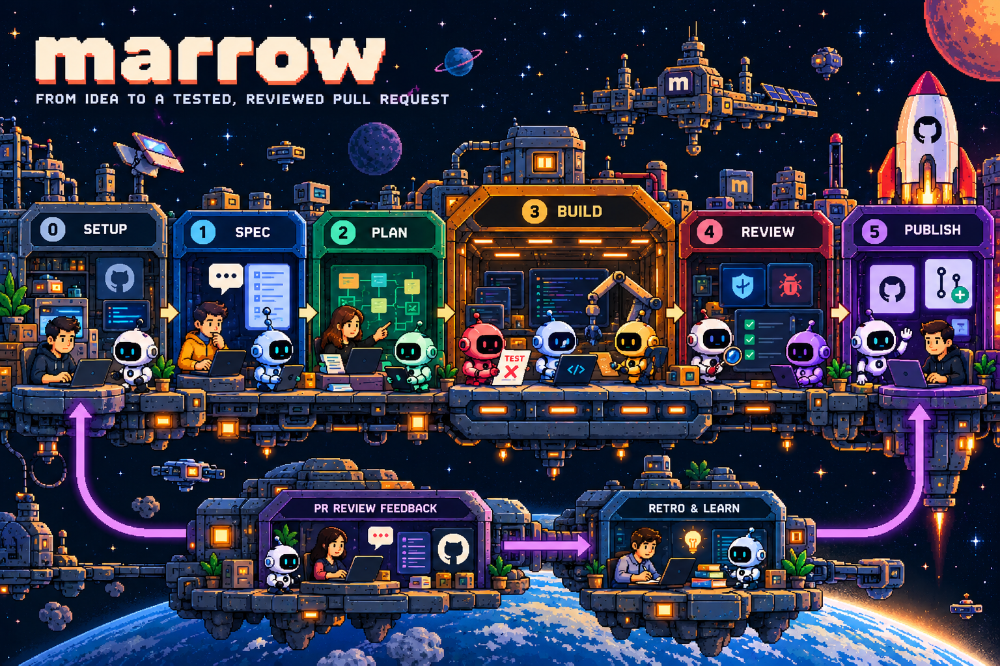
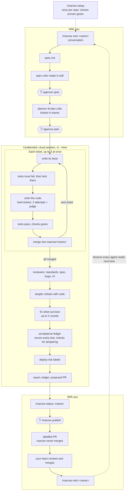

# Using marrow



Marrow turns a conversation into a reviewed, tested PR. You approve the spec, the plan and the PR; everything in between runs unattended, by default in a Claude Code cloud session. For the design rationale, see the [README](../README.md).



## Install

You need Claude Code (logged in to claude.ai), `git`, `jq`, `python3` and `perl`. Cloud builds and publishing also need a GitHub `origin`, the Claude GitHub app on the repo, and `gh` logged in.

```bash
./install.sh   # in your marrow clone; safe to re-run
```

Restart Claude Code afterwards. `/marrow` now works in every repo and runs whatever branch your clone has checked out.

## Set up a repo: `/marrow setup`

Once per repo. Claude reads your CI, tests and docs, then asks a few questions (each with a suggested answer): which checks every ticket must pass, what services tests need, whether tickets can run in parallel, cloud or local builds, unwritten conventions, and whether to share the setup with your team. It writes `.marrow/checks` and `.marrow/notes.md`, and won't finish until the checks pass on a clean copy of your base branch.

## Build a feature

| Command | What happens |
| --- | --- |
| `/marrow new <name>` | Claude interviews you one question at a time, writes `spec.md`, has a critic read it cold, and asks you to approve. Then it plans tickets and asks again. Saying yes starts the build. |
| `/marrow status <name>` | The result: status, failing criteria, open findings and human steps. |
| `/marrow publish <name>` | Opens the PR with [deploy-risk labels](#deploy-risk-labels). Marrow never merges it. |
| `/marrow retro <name>` | After review, turns the PR's comments into lessons every agent reads next time. |

Tips for the interview: say why, not just what; accept a suggested split if the feature is big; "what would you do?" is a fine answer.

Build options: `--here` builds on this machine (no GitHub, local services, or to watch); `--lite` skips the standards reviewer and allows one fix round instead of two. `/marrow build <name>` starts or restarts a build; `/marrow plan <name>` re-plans an approved spec.

**Statuses.** A build is `green` (all built and passing), `partial` (some tickets not built), `red` (a criterion failed or was tampered with, or checks are red) or `blocked` (couldn't start). Each criterion is `pass`, `fail`, `tampered` (its tests changed after locking), `manual` or `not-built`.

## Other commands

- `/marrow review <branch> [spec]`: runs the reviewers and checks over any branch, read-only. Pass an absolute spec path to include the spec reviewer.
- `/marrow runs`: every run in the repo and how far it got.

## Deploy-risk labels

Fixed rules, not a model, scan the diff when you publish. The PR body gets a **Deploy risk** section with a `?` for each thing you must answer before merging.

| Label | When the branch | Before you deploy |
| --- | --- | --- |
| `needs-env` | reads or sets a new env var | Set it everywhere. |
| `needs-secret` | references a new secret | Create it and grant access. |
| `db-migration` | adds or changes a migration | Check it's additive and safe to roll back. |
| `destructive-migration` | drops, renames, retypes or deletes data | Ship the release that stopped using it first; back up. |

Moved names aren't flagged. Missing labels are created; labels are only ever added.

## When things go wrong

- **Build stopped or red:** fix the cause and run `/marrow build <name>` again. Merged tickets are skipped (on a fresh cloud machine too, if the branch was pushed). Say yes when asked to replace the run branch.
- **"Spec changed" or "plan changed":** you edited it after approving. Run `/marrow new <name>` to re-approve.
- **Checks red on the base branch:** every build would fail. Fix it, or rerun `/marrow setup`.
- **`tampered`:** `ledger.json` lists the test files that changed; inspect them before trusting the build.
- **Can't load a workflow:** rerun `./install.sh` and restart Claude Code.
- **Agent blocked by the guard:** intended. Agents only touch their ticket's files, and only one may push. See `agent-log.md`.
- **Cloud launch didn't start:** run the printed command with `!` in front.

## Where things live

```
.marrow/
  checks, notes.md      the setup
  README.md             overview of every run
  <date>-<name>/        one folder per run: spec.md, plan.md, report.md,
                        agent-log.md, ledger.json, pr.md, published.json
```

`.marrow/` stays out of git unless you share the setup. Builds happen in `.claude/worktrees/marrow-*` on the branch `marrow/<name>`, so your checkout is never touched. Marrow never merges, never pushes anything but its own branches, and never credits an AI in commits or PRs.
